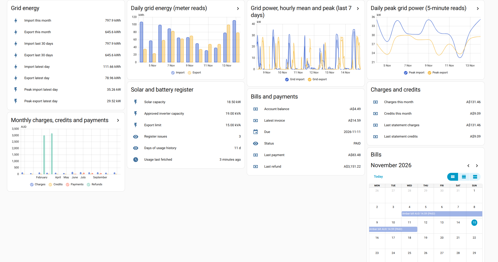
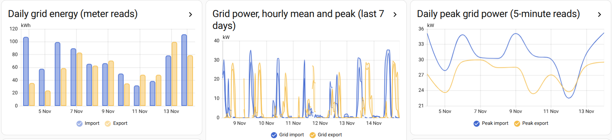
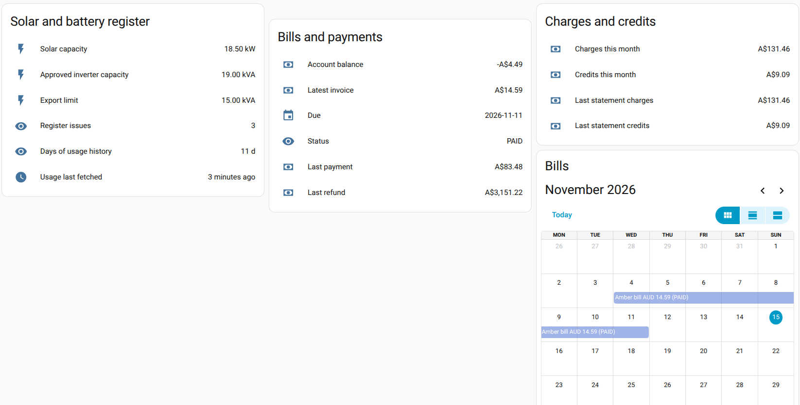

# openfeed Consumer Data Right for Home Assistant

Bring your own Consumer Data Right (CDR) energy data into Home Assistant through
[openfeed](https://openfeed.au). You get your retailer's half-hourly meter reads in the
Energy dashboard, your account balance and latest bill as sensors, and optionally your
bank balances.



| Version | Home Assistant | Status |
|---|---|---|
| 0.1.7 | 2026.4 or later | Current: plan tariff sensors, meter detail sensors |
| 0.1.0 | 2026.4 or later | First release |

## How it works

The [Consumer Data Right](https://www.cdr.gov.au/) lets you direct a data holder (your
energy retailer or bank) to share your data with an accredited data recipient. Only
ACCC-accredited providers can offer CDR services.

openfeed is the accredited recipient. You connect your retailer and bank to openfeed once.
This integration then receives your data from openfeed by onward disclosure, under a
sharing grant you approve and can revoke at any time from the openfeed dashboard. The
integration never talks to your retailer or bank directly.

Two consents are involved:

1. **openfeed sign-in.** You sign in to openfeed and approve this Home Assistant app.
2. **Disclosure grant.** You choose which accounts openfeed shares with the app.

Revoking the grant in openfeed stops data immediately. The integration discards cached
data and asks you to reconnect.

## What you get

| Data | Entity or statistic | Freshness |
|---|---|---|
| Grid consumption, export, controlled load | External statistics `openfeed:nmi_<nmi>_consumption`, `_export`, `_controlled_load` (hourly, kWh) | Batch; openfeed refreshes every 6 hours, meter data usually lags a day |
| Grid import and export power | External statistics `openfeed:nmi_<nmi>_consumption_power`, `_export_power` (hourly mean, min and max, kW, from the meter's 5 or 30 minute reads) | As above |
| Latest full day per series | `sensor.meter_<nmi>_latest_day_grid_*` | As above |
| Latest full day peak import and export | `sensor.meter_<nmi>_latest_day_peak_grid_import`, `_export` (kW, with the interval start) | As above |
| Account balance | `sensor.energy_<account>_account_balance` | Live, cached up to 15 minutes |
| Latest invoice amount, due date, status | `sensor.energy_<account>_latest_invoice_*` | Hourly poll |
| Plan name, fees, discounts and incentives | `sensor.energy_<account>_plan` (only when the retailer shares a plan) | Daily |
| Current import rate | `sensor.energy_<account>_import_rate` (AUD/kWh including GST; rate excluding GST, stepped blocks and network/retail components as attributes) | Re-evaluated every minute from the plan |
| Time-of-use period | `sensor.energy_<account>_tariff_period` (`single_rate`, `peak`, `off_peak`, `shoulder`, `shoulder1`, `shoulder2`) | Every minute |
| Feed-in rate | `sensor.energy_<account>_feed_in_rate` (AUD/kWh as published, retailer and government schemes added) | Every minute |
| Daily supply charge | `sensor.energy_<account>_daily_supply_charge` (AUD/day including GST) | Every minute |
| Demand charge | `sensor.energy_<account>_demand_charge` (including GST, only on demand tariffs) | Every minute |
| Next tariff change | `sensor.energy_<account>_next_tariff_change` (timestamp, looks two days ahead) | Every minute |
| Meter detail | `sensor.meter_<nmi>_meter_status`, `_meter_read_type`, `_jurisdiction`, `_service_point_classification`, `_generator`, and `_nmi` (disabled by default). Every meter detail field is also an attribute of the status sensor | Daily |
| Month-to-date charges and credits | `sensor.energy_<account>_month_to_date_charges`, `_credits`, with a split by transaction type (only when the retailer shares billing transactions) | Every 6 hours |
| Billing and invoice history | External statistics `openfeed:acct_<hash>_charges` (gross charges), `_credits` (credits), `_payments` (money you paid), `_refunds` (money paid back to you), `_invoiced` (AUD). All but invoiced are positive amounts | Every 6 hours |
| Last payment and last refund | `sensor.<account>_last_payment`, `_last_refund` (amount, with date and method). The refund sensor only appears once a refund has been paid | Every 6 hours |
| Sidebar dashboard | **Energy data** in the sidebar, at `/openfeed` | Live |
| DER approved capacity and export limit | `sensor.meter_<nmi>_der_*` (when the retailer publishes DER data) | Hourly poll |
| DER equipment and solar capacity | `sensor.meter_<nmi>_der_solar_capacity`, with every inverter and device as attributes | Hourly poll |
| DER register issues | `sensor.meter_<nmi>_der_register_issues` | Hourly poll |
| Month-to-date and last 30 days grid import and export | `sensor.meter_<nmi>_month_to_date_grid_*`, `_last_30_days_grid_*` (kWh, full days only) | With usage |
| Last statement charges and credits | `sensor.<account>_last_statement_charges`, `_credits` (with net and the statistic IDs as attributes) | Every 6 hours |
| Bills calendar | `calendar.<account>_bills`: one event per invoice, from issue date to due date, with amount and status | Hourly poll |
| Usage history held | `sensor.meter_<nmi>_usage_history` (days, with oldest date and every statistic ID) | With usage |
| Substituted intervals | `sensor.meter_<nmi>_substituted_intervals` | With usage |
| Bank current and available balance (optional) | `sensor.bank_<account>_*_balance` | Live, cached up to 15 minutes |

Add the three external statistics in **Settings > Dashboards > Energy** under grid
consumption and return to grid. The first load imports 60 days of history (change it in
the integration options, up to 365). After that the last 7 days are re-imported every
3 hours so late and substituted reads are corrected.

Basic (accumulation) meter reads are not imported to statistics; only interval reads are.

### Finding the data

Most of the history lives in long-term statistics, which have no entity. Three places
surface it:

- **Sensors and calendar.** The summary sensors and bills calendar above answer the
  common questions directly, and each lists the statistic IDs it relates to.
- **Device page.** The meter device's **Visit** link opens the Energy settings, where
  you can add the import and export statistics as a grid source. Only do this if no
  other grid meter feeds your Energy dashboard, or energy is counted twice.
- **Sidebar dashboard.** See below. If you would rather build your own,
  [docs/dashboard.yaml](docs/dashboard.yaml) is the same layout as a view you can
  paste into any dashboard.

### Sidebar dashboard

The integration adds **Energy data** to the sidebar. It is generated from your shared
accounts and meters each time it opens, so it needs no setup and updates with each
release. It is read-only; to customise it, copy the cards from
[docs/dashboard.yaml](docs/dashboard.yaml) into your own dashboard. Turn it off in
**Settings > Devices & services > openfeed > Configure**.

| Section | What it shows |
|---|---|
| Grid energy | Import and export this month, last 30 days and latest day, with latest-day peaks |
| Daily grid energy | 30 days of daily import and export from the meter |
| Grid power | 7 days of hourly mean and peak import and export power |
| Daily peak grid power | 30 days of the highest 5-minute import and export |
| Solar and battery register | DER capacity, export limit, register issues and history depth |
| Bills and payments | Balance, latest invoice, last payment and last refund |
| Charges and credits | This month and last statement |
| Monthly charges, credits and payments | 12 months of each as bars |
| Bills | Invoices on a calendar |





Grid power is a day behind, because it comes from your retailer's meter reads. It is
held as long-term statistics, not as an entity, so it does not appear in the History
panel. Use the dashboard or **Developer tools > Statistics** (search "grid import
power").

### How much history

openfeed imports some history when you first connect a retailer, then adds new data
every 6 hours. The `usage_last_fetched` sensor shows the oldest and latest usage dates
openfeed returned, and diagnostics show the oldest invoice and billing transaction.
Home Assistant keeps long-term statistics permanently, so history builds up from the
day you connect even if openfeed only holds a rolling window.

Home Assistant long-term statistics are hourly. The energy statistics are hourly sums;
the power statistics keep the hourly maximum of the meter's own interval reads, so a
5-minute peak is not lost.

### Billing

Retailers usually date every billing line on the statement date, so the money
statistics step once a month rather than daily.

Payments and refunds are kept apart. The CDR standard defines a payment amount only as
"the amount paid", and retailers use the account ledger convention where a credit to
your account is negative. So a negative payment line is a payment you made, and a
positive payment line is money paid back to you, such as a refund of a credit balance.
Both are stored as positive amounts in their own series.

Feed-in credits only appear if your retailer itemises them as billing lines. Some
retailers net them into the invoice instead, so the invoice can be well below the
charges.

Diagnostics list every billing line (date, type, amount, GST, payment method) without
descriptions, invoice numbers or meter IDs, so you can check how your retailer reports
credits and refunds.

### Plan tariff

When the retailer shares a plan with tariff detail, the integration works out which
rate applies now from the plan's seasonal periods, time-of-use windows, time zone
(`LOCAL` or `AEST`) and feed-in tariffs. CDR unit prices and supply charges exclude
GST, so the sensors add 10% and keep the published figure as `rate_ex_gst` or
`charge_ex_gst`. Feed-in rates are shown as published. Windows that only apply on
public holidays are ignored, because there is no holiday calendar.

The tariff sensors only appear when the plan carries tariff detail. Some retailers
share no plan: Amber, for example, returns none, because its prices follow the
wholesale market. The diagnostics show `tariff_detail_shared`.

### Meter detail

The meter sensors come from openfeed's meter detail endpoint, read once a day: status,
read type (interval or daily), jurisdiction, service point classification and whether
the service point is registered as a generator. If that endpoint fails, they fall back
to the meters list and the status sensor's `detail_source` attribute shows `list`.
Generator shows unknown when the retailer does not report it.

### DER register

The DER data comes from AEMO's DER Register via your retailer. Your network (DNSP)
maintains it from the connection applications your installer lodges, so it can drift
from what is on site. The DER register issues sensor flags:

| Issue | Meaning |
|---|---|
| `decommissioned_records_listed` | Removed equipment is still on the record |
| `battery_inverter_without_storage_device` | A battery inverter is listed with no storage device |
| `solar_panels_on_battery_inverter` | Solar panels are attached to a battery inverter |
| `active_inverters_exceed_approved_capacity` | Active inverter capacity is above the approved capacity |
| `no_active_equipment` | Nothing on the record is active |

To correct the record, ask your installer to lodge an alteration with your network, or
contact the network directly. Your retailer cannot edit it.

## Scopes

| Scope | Why |
|---|---|
| `openid` | Identifies your openfeed user so one Home Assistant entry maps to one person |
| `offline_access` | Refresh tokens, so Home Assistant stays connected without signing in again |
| `openfeed-au:data:energy:read` | Accounts, plans, balances, billing, invoices, meters, usage and DER |
| `openfeed-au:data:banking:read` | Only when you tick "Also share banking data" |

Bank transactions, payment schedules and personal details are not requested.

## Setup

1. Install the integration (see below). A first Marketplace install needs no restart.
2. Go to **Settings > Devices & services > Add integration > openfeed Consumer Data Right**.
3. The first screen shows a public JSON Web Key Set (JWKS). Home Assistant generated the
   keys; the private keys never leave Home Assistant.
4. In a new tab, [register an app on openfeed](https://app.openfeed.au/registered-apps/new):
   - Client authentication: **private_key_jwt**.
   - Keys: **Inline JWKS JSON**. Paste the JWKS from step 3.
   - Scopes: energy, and banking if you want it.
5. Copy two values back into Home Assistant:
   - **OAuth2 client ID**, which starts with `app-`.
   - **App ID**, the bare UUID.
6. Check the Home Assistant URL. openfeed sends your browser back to
   `<url>/api/openfeed/callback`, so it must be reachable from the browser you sign in
   with. It does not need to be reachable from the internet. See
   [Nabu Casa and remote access](#nabu-casa-and-remote-access).
7. Sign in to openfeed, approve the app, then choose the accounts to share.

To change which accounts are shared, or the Home Assistant URL, use **Reconfigure** on
the integration. The existing grant is updated in place rather than a new one created.

## Nabu Casa and remote access

The integration works with Home Assistant Cloud (Nabu Casa), your own domain, or a
local address only.

- **No inbound connection after setup.** Home Assistant polls `api.openfeed.au`. There
  is no webhook, so you do not need Nabu Casa webhooks, port forwarding or a public URL
  for data to flow.
- **Sign-in is a browser redirect.** During setup, reauth and reconfigure, openfeed sends
  your browser back to `<Home Assistant URL>/api/openfeed/callback` and
  `/api/openfeed/consent/<state>`. openfeed's servers never call Home Assistant, so the
  URL only has to work in the browser you use.
- **No redirect URI to register.** openfeed takes the redirect URI from each signed
  pushed authorisation request, so the app registration has no redirect field and any
  URL works.
- **Default URL.** The setup form fills in your external URL, or your Nabu Casa remote
  URL (`https://<id>.ui.nabu.casa`) when no external URL is set, or else your internal
  URL.

| You sign in from | Use this Home Assistant URL |
|---|---|
| Anywhere, with Nabu Casa | Your Nabu Casa remote URL, `https://<id>.ui.nabu.casa` |
| Anywhere, with your own domain | Your domain, for example `https://ha.example.com` |
| A browser on your home network | Your local URL, for example `http://homeassistant.local:8123` |
| The Home Assistant Companion app | A URL that works away from home, usually the Nabu Casa remote URL |

The URL is saved with the entry and only used again for reauth and reconfigure. If you
change how you reach Home Assistant, update it with **Reconfigure**.

## Costs

openfeed is free for consumers. As the registered app owner you are also the developer:
openfeed debits 1 credit per active grant when it is created and on each monthly
anniversary. The first 10 credits are free; see [openfeed pricing](https://openfeed.au/pricing).
When credits run out openfeed suspends the grant. Home Assistant raises a repair issue
and resumes automatically once you top up.

## Security

The integration follows openfeed's FAPI 2.0 profile:

- Pushed authorisation requests (PAR) with PKCE S256.
- `private_key_jwt` client authentication, PS256.
- DPoP sender-constrained tokens; every API call carries a fresh proof bound to the
  access token, with server nonces honoured.
- RFC 9207 `iss` check on the sign-in redirect, and id_token signature, audience and
  nonce verification.
- Diagnostics redact tokens, keys, account numbers, names, NMIs, meter IDs and
  equipment identifiers.

See [PRIVACY.md](PRIVACY.md) for what the integration collects and where it goes.

## Install

### HACS

Add `https://github.com/purcell-lab/ha-openfeed` as a custom repository of type
Integration, then install **openfeed Consumer Data Right**. A first install needs no
restart. Updates need a restart, because Home Assistant only loads new code at start-up.

### Manual

Copy `custom_components/openfeed` into your Home Assistant `config/custom_components/`
directory and restart.

## Development

```
pip install -r requirements-test.txt
pytest
ruff check .
```

The OAuth, DPoP, API client and usage aggregation modules (`crypto.py`, `oauth.py`,
`api.py`, `usage.py`) have no Home Assistant imports and are tested on their own.
Config flow and entry setup are tested with `pytest-homeassistant-custom-component`.

## Disclaimer

This is an independent project. It is not affiliated with or endorsed by openfeed,
Biza Pty Ltd, or the ACCC. openfeed's terms govern your use of openfeed.

## Licence

MIT
